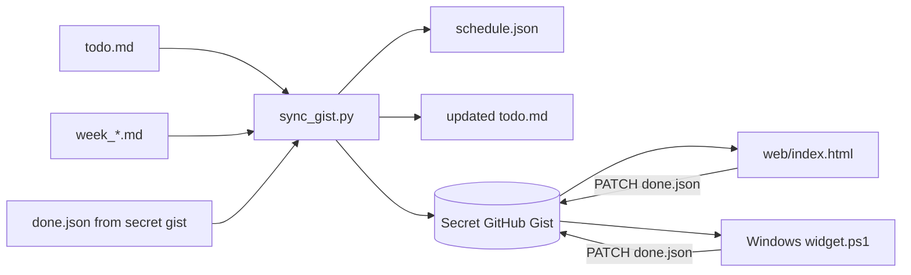

# 滚滚日程 RollingDay

> J人福音，P人救星：可实时滚动勾选的个人日程管理器（自用）

RollingDay 是一个轻量的个人日程工具：用 Markdown 写日程和待办，用一个 secret GitHub Gist 同步 `schedule.json` / `done.json`，再在手机网页或 Windows 桌面悬浮小组件里自动滚动查看、实时勾选。

## Demo

| 手机网页 demo | 小组件尺寸 demo |
| --- | --- |
|  |  |

- MP4：[`docs/demo-mobile.mp4`](docs/demo-mobile.mp4)、[`docs/demo-widget.mp4`](docs/demo-widget.mp4)。
- 小组件尺寸 demo 是 `web/index.html?demo=1` 以 `300x380` 视口渲染的录屏，用于展示与 Windows 小组件相近的紧凑滚动观感；不是原生 WPF 窗口录屏。
- 本 demo 使用 `examples/schedule.json` 和 `examples/done.json` 中的虚构中文学生日程。

## 功能

- 手机网页：读取 gist 中的 `schedule.json` / `done.json`，自动滚动今天及之后的日程块和待办。
- 待办勾选：网页端用 GitHub API PATCH `done.json`，token 仅保存在当前浏览器 `localStorage`。
- Markdown 同步：`sync/sync_gist.py` 从 `todo.md` 和 `week_*.md` 生成 `schedule.json`，并把远端 `done.json` 合并回 `todo.md`。
- Windows 小组件：PowerShell + WPF always-on-top 滚动窗口，支持勾选待办；token 用 Windows DPAPI 加密保存在本机。
- 可配置：gist owner/id、文件路径、时区、课程节次时间都由配置文件、环境变量或网页 URL 参数提供。

## 目录结构

```text
web/index.html                    # 手机/浏览器页面
desktop/windows/widget.ps1        # Windows WPF 悬浮小组件
desktop/windows/install_startup.ps1# 安装到开机启动
sync/sync_gist.py                 # Markdown -> gist 同步脚本
sync/config.example.json          # 同步脚本配置示例
examples/todo.md                  # 待办 Markdown 格式示例
examples/week_example.md          # 周日程 Markdown 格式示例
examples/schedule.json            # 本地 demo 日程数据
examples/done.json                # 本地 demo 勾选数据
docs/demo-*.mp4 / docs/demo-*.gif # demo 录屏
```

## 工作方式



## 快速开始

### 1. 创建 secret gist

在 GitHub 创建一个 **Secret gist**。可以先放两个空文件：

`schedule.json`

```json
{"updated_at":"","current":null,"next":null,"days":[],"todos":[]}
```

`done.json`

```json
{"done":[]}
```

也可以让 `sync/sync_gist.py` 在首次同步时自动创建 secret gist。

### 2. 创建 GitHub token

创建一个只用于 RollingDay 的 GitHub token，并授予 `gist` 权限。不要把 token 写进仓库、Markdown、README 或截图里。

推荐用环境变量提供：

```bash
export ROLLINGDAY_GIST_TOKEN="<your-gist-token>"
```

### 3. 准备 Markdown 数据

把示例复制到你自己的私有目录，例如：

```bash
mkdir -p ~/rollingday-data
cp examples/todo.md ~/rollingday-data/todo.md
cp examples/week_example.md ~/rollingday-data/week_2026.md
```

`todo.md` 格式：

```md
- [ ] 标题 | 截止时间 | 优先级 | 备注
```

`week_*.md` 格式：

```md
## 10/22 四
- 09:00-10:30 深度工作：整理需求
- 课: 1-2 示例课程 A; 3-4 示例课程 B
- 这是没有起止时间的备注
```

默认课程节次可在 `sync/config.json` 的 `slots` 里改。

### 4. 配置并运行同步脚本

复制配置模板：

```bash
cp sync/config.example.json sync/config.json
```

编辑 `sync/config.json`：

```json
{
  "gist_id": "<gist_id>",
  "gist_owner": "<gist_owner>",
  "timezone": "Asia/Shanghai",
  "data_dir": "/path/to/rollingday-data",
  "todo_file": "/path/to/rollingday-data/todo.md",
  "week_glob": "/path/to/rollingday-data/week_*.md",
  "days": 7,
  "publish_web": false
}
```

运行 dry run：

```bash
python3 sync/sync_gist.py --config sync/config.json --dry-run
```

确认无误后同步到 gist：

```bash
python3 sync/sync_gist.py --config sync/config.json
```

如果你不想写 `gist_id` 到配置文件，也可以用环境变量：

```bash
export ROLLINGDAY_GIST_ID="<gist_id>"
export ROLLINGDAY_GIST_OWNER="<gist_owner>"
export ROLLINGDAY_DATA_DIR="/path/to/rollingday-data"
export ROLLINGDAY_TODO_FILE="/path/to/rollingday-data/todo.md"
export ROLLINGDAY_WEEK_GLOB="/path/to/rollingday-data/week_*.md"
python3 sync/sync_gist.py
```

### 5. 用 cron 定时同步

示例：每 10 分钟同步一次。

```cron
*/10 * * * * cd /path/to/RollingDay && ROLLINGDAY_GIST_TOKEN=<your-gist-token> python3 sync/sync_gist.py --config sync/config.json >> /tmp/rollingday.log 2>&1
```

更安全的做法是把 token 放在系统 keychain、CI secret、加密环境文件或只对当前用户可读的 shell profile 中。

### 6. 打开网页并添加到手机桌面

本地打开：

```text
web/index.html?gist=<gist_owner>/<gist_id>&tz=Asia/Shanghai
```

通过 HTMLPreview 打开仓库里的页面时，可使用类似链接：

```text
https://htmlpreview.github.io/?https://github.com/<repo-owner>/<repo-name>/blob/main/web/index.html%3Fgist%3D<gist_owner>/<gist_id>%26tz%3DAsia/Shanghai
```

本地 demo 模式无需 gist 或 token，会读取 `examples/schedule.json` / `examples/done.json`，勾选只保存在当前浏览器：

```text
web/index.html?demo=1&tz=Asia/Shanghai
```

首次勾选待办时，网页会提示输入 GitHub token。该 token 只保存在当前浏览器的 `localStorage`。如果要清除，点击页面底部的“重置 token”，或清理浏览器站点数据。

在 iOS Safari / Android Chrome 中打开网页后，选择“添加到主屏幕”即可当作轻量 PWA 使用。

### 7. 安装 Windows 悬浮小组件

在 PowerShell 中运行：

```powershell
Set-ExecutionPolicy -Scope CurrentUser RemoteSigned
.\desktop\windows\install_startup.ps1 -Gist "<gist_owner>/<gist_id>" -Timezone "China Standard Time"
```

安装脚本会：

1. 复制 `widget.ps1` 到 `%APPDATA%\RollingDay\widget.ps1`；
2. 写入 `%APPDATA%\RollingDay\config.json`；
3. 创建 Startup 快捷方式 `RollingDay.lnk`。

首次勾选待办时，小组件会提示输入 GitHub token，并用 Windows DPAPI 加密保存到 `%APPDATA%\RollingDay\token.dat`。

## 配置项

### 网页 URL 参数

- `gist=owner/gist_id`：推荐格式。
- `id=gist_id&owner=owner`：等价写法。
- `tz=Asia/Shanghai` 或 `timezone=Asia/Shanghai`：浏览器显示和“今天”判断使用的时区。

网页会把 gist 和时区保存到 `localStorage`，下次可以省略参数。

### 同步脚本环境变量

- `ROLLINGDAY_GIST_TOKEN`：GitHub token，等价兼容 `GITHUB_GIST_TOKEN`。
- `ROLLINGDAY_GIST_ID`
- `ROLLINGDAY_GIST_OWNER`
- `ROLLINGDAY_DATA_DIR`
- `ROLLINGDAY_TODO_FILE`
- `ROLLINGDAY_WEEK_GLOB`
- `ROLLINGDAY_TIMEZONE`

### Windows 小组件配置

`%APPDATA%\RollingDay\config.json`：

```json
{
  "gist": "owner/gist_id",
  "timezone": "China Standard Time",
  "width": 300,
  "height": 380
}
```

## 安全说明

- 不要提交 GitHub token、真实 gist id、真实日程、真实路径或个人信息。
- 推荐使用 secret gist，但“secret”不是访问控制；知道 gist id 的人可能读取内容。不要放敏感日程、密码、证件、地址等信息。
- token 只需要 `gist` 权限，建议专门创建、定期轮换。
- 网页 token 存在浏览器 `localStorage`；这适合自用，不适合共享设备。
- Windows 小组件 token 用当前 Windows 用户的 DPAPI 加密；换用户或换机器后不能直接解密。
- `sync/config.json` 默认被 `.gitignore` 忽略，因为它可能包含私有 gist id、路径或 token。

## English quick start

RollingDay is a tiny personal rolling schedule manager. Write todos and weekly blocks in Markdown, sync them into a secret GitHub Gist, then view and check them from a mobile web page or a Windows always-on-top widget.

Minimal setup:

1. Create a secret GitHub Gist with `schedule.json` and `done.json`.
2. Create a GitHub token with `gist` scope.
3. Copy `examples/todo.md` and `examples/week_example.md` to a private data directory.
4. Copy `sync/config.example.json` to `sync/config.json` and point it to your data directory and gist.
5. Run `python3 sync/sync_gist.py --config sync/config.json`.
6. Open `web/index.html?gist=<gist_owner>/<gist_id>&tz=Asia/Shanghai`.
7. On Windows, run `desktop/windows/install_startup.ps1 -Gist "<gist_owner>/<gist_id>"`.

## License

MIT
