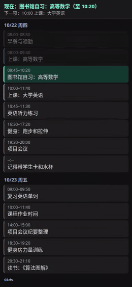
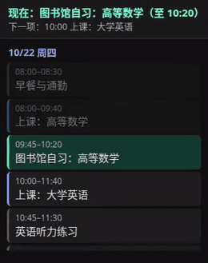
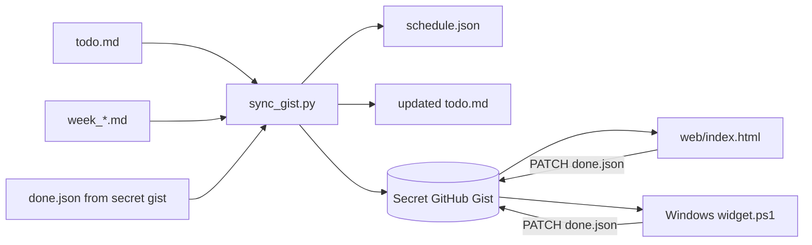
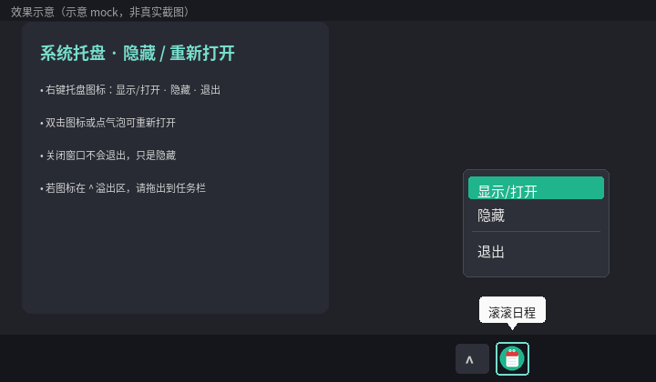

# 滚滚日程 RollingDay

> J人福音，P人救星：可实时滚动勾选的个人日程管理器

RollingDay 是一个轻量的个人日程工具：用 Markdown 写日程和待办，用一个 secret GitHub Gist 同步 `schedule.json` / `done.json`，再在手机网页或 Windows 桌面悬浮小组件里自动滚动查看、实时勾选。

## Demo

| 手机网页 demo | 小组件尺寸 demo |
| --- | --- |
|  |  |

- MP4：[`docs/demo-mobile.mp4`](docs/demo-mobile.mp4)、[`docs/demo-widget.mp4`](docs/demo-widget.mp4)。
- 小组件尺寸 demo 是 `web/index.html?demo=1` 以 `300x380` 视口渲染的录屏，用于展示与 Windows 小组件相近的紧凑滚动观感；不是原生 WPF 窗口录屏。
- 本 demo 使用 `examples/schedule.json` 和 `examples/done.json` 中的虚构中文学生日程。


## 手机 PWA（本机存储）

无需 GitHub token / gist，打开即可用；数据只存在手机浏览器的 `localStorage`，首次加载后可离线使用。

**地址：** [https://bolt2012-china.github.io/RollingDay/app/](https://bolt2012-china.github.io/RollingDay/app/)

落地页：[https://bolt2012-china.github.io/RollingDay/](https://bolt2012-china.github.io/RollingDay/)

### 添加到主屏幕

**iOS Safari**

1. 用 Safari 打开上面的 PWA 地址；
2. 点底部分享按钮（方框+向上箭头）；
3. 下滑选择「添加到主屏幕」→「添加」。

**Android Chrome**

1. 用 Chrome 打开上面的 PWA 地址；
2. 点右上角 ⋮ 菜单；
3. 选择「添加到主屏幕」或「安装应用」→ 确认。

### 怎么输入

顶部输入一行，按回车或点「添加」：

```text
周四-19:30-补DSP
周五-08:00-09:45-高等数学
今天-09:00-开会
明天-交作业
买菜
```

- `周几-开始-事件` 或 `周几-开始-结束-事件`；`今天` / `明天` 也可当周几。
- 没有时间的行当作待办。
- **手势：** 轻点标记完成；左滑露出「编辑 / 删除」（删除需确认）；长按打开编辑（星期、时间、标题、提前提醒）。
- **提醒（尽力而为）：** 设置里开启「日程提醒」并允许通知。默认可提前 0/5/10/15/30 分钟；单条可覆盖。实现上优先用 Chrome 的 Notification Triggers（`TimestampTrigger`），否则靠 Service Worker + IndexedDB 待发队列，以及页面打开时的定时器/补发。**不能写入系统闹钟**；Android Chrome 较稳，iOS Safari/PWA 通知能力有限。
- **v6 双提醒：** 每个有时间的日程默认提醒两次——提前量（默认 10 分钟）一次、开始时间准点一次；设置里可关闭「准点再提醒一次」。每条提醒只发一次（localStorage 去重）。
- **同步页提醒（web/index.html）：** 左下角「提醒」开关（点击时申请通知权限）。页面打开期间对当天日程提前 10 分钟 + 准点各提醒一次；优先 Service Worker `showNotification`，否则 `new Notification`；浏览器不支持通知（常见于 Android 自带浏览器）时改用页内横幅 + 振动 + 提示音。**必须保持页面打开**，关闭或进入后台后网页无法响铃。
- 设置（⚙）还可「导出到系统日历」（`.ics`）、导出/导入 JSON 或清空数据。更新后请硬刷新或重新打开主屏幕图标，以便加载新版 Service Worker（当前 **v7**）。

### 导出到系统日历（普通用户，无需 Gist）

网页提醒依赖浏览器通知，锁屏后不一定准。设置（⚙）→ **导出到系统日历** 会把本机日程生成为 `rollingday.ics`（RFC 5545）并下载：

- 有时间的日程：两个闹钟提醒（提前 10 分钟、开始时）；
- 有日期的待办：作为全天事件，当天约 8:50 / 9:00 提醒；
- 已完成的条目会跳过。

下载后用系统「日历」打开该文件即可导入。**华为 / HarmonyOS** 一般不能按 URL 订阅日历，请下载一次后用日历 App 打开导入。日程有改动时请重新导出；导入前先删除旧的「滚滚日程」事件，以免重复。

> 若仍想用 secret gist 跨设备同步，请继续用下方的 `web/index.html` + `sync/sync_gist.py` 流程。

## 功能

- 手机 PWA：一行输入日程，本机存储、可离线、可添加到主屏幕；支持浏览器通知提醒与左滑/长按编辑（见上一节）。
- 手机网页（gist 版）：读取 gist 中的 `schedule.json` / `done.json`，自动滚动今天及之后的日程块和待办。
- 待办勾选：网页端用 GitHub API PATCH `done.json`，token 仅保存在当前浏览器 `localStorage`。
- 编辑 / 删除手势（gist 网页 + Windows 小组件）：手机上长按条目打开编辑面板（改时间/内容、删除），左滑露出「编辑 / 删除」；桌面上长按左键或右键条目弹出「编辑 / 删除」菜单，按住向左拖同样露出按钮。改动立即显示，并追加到 gist 的 `edits.json`（`{eid, id, type, action: edit|delete, fields}`）。
- Markdown 同步：`sync/sync_gist.py` 从 `todo.md` 和 `week_*.md` 生成 `schedule.json`，并把远端 `done.json` 合并回 `todo.md`；同时把 `edits.json` 中的编辑/删除幂等地应用到 `todo.md` / `week_*.md`（日程块带稳定 id），应用后从 `edits.json` 清除。
- Windows 小组件：PowerShell + WPF always-on-top 滚动窗口，支持勾选待办与右键/长按/左拖编辑删除；系统托盘可隐藏/重新打开；token 用 Windows DPAPI 加密保存在本机。
- 可配置：gist owner/id、文件路径、时区、课程节次时间都由配置文件、环境变量或网页 URL 参数提供。

## 目录结构

```text
web/index.html                       # gist 版手机/浏览器页面
docs/index.html                      # GitHub Pages 落地页
docs/app/                            # 手机 PWA（本机存储，可离线）
docs/app/index.html                  # PWA 主页面
docs/app/manifest.webmanifest        # Web App Manifest
docs/app/sw.js                       # Service Worker
docs/app/icons/                      # 192/512 青绿日历图标
desktop/windows/widget.ps1           # Windows WPF 悬浮小组件（含托盘）
desktop/windows/install_startup.ps1  # 安装到开机启动（-STA + 图标）
desktop/windows/schedule.ico         # 托盘/快捷方式图标（青绿日历）
sync/sync_gist.py                    # Markdown -> gist 同步脚本
sync/config.example.json             # 同步脚本配置示例
examples/todo.md                     # 待办 Markdown 格式示例
examples/week_example.md             # 周日程 Markdown 格式示例
examples/schedule.json               # 本地 demo 日程数据
examples/done.json                   # 本地 demo 勾选数据
docs/demo-*.mp4 / docs/demo-*.gif    # demo 录屏
docs/demo-tray.png                   # 托盘隐藏/重新打开效果示意
```

## 工作方式



## 快速开始

### 1. 创建 secret gist

在 GitHub 创建一个 **Secret gist**。可以先放两个空文件：

`schedule.json`

```json
{"updated_at":"","current":null,"next":null,"days":[],"todos":[]}
```

`done.json`

```json
{"done":[]}
```

也可以让 `sync/sync_gist.py` 在首次同步时自动创建 secret gist。

### 2. 创建 GitHub token

创建一个只用于 RollingDay 的 GitHub token，并授予 `gist` 权限。不要把 token 写进仓库、Markdown、README 或截图里。

推荐用环境变量提供：

```bash
export ROLLINGDAY_GIST_TOKEN="<your-gist-token>"
```

### 3. 准备 Markdown 数据

把示例复制到你自己的私有目录，例如：

```bash
mkdir -p ~/rollingday-data
cp examples/todo.md ~/rollingday-data/todo.md
cp examples/week_example.md ~/rollingday-data/week_2026.md
```

`todo.md` 格式：

```md
- [ ] 标题 | 截止时间 | 优先级 | 备注
```

`week_*.md` 格式：

```md
## 10/22 四
- 09:00-10:30 深度工作：整理需求
- 课: 1-2 示例课程 A; 3-4 示例课程 B
- 这是没有起止时间的备注
```

默认课程节次可在 `sync/config.json` 的 `slots` 里改。

### 4. 配置并运行同步脚本

复制配置模板：

```bash
cp sync/config.example.json sync/config.json
```

编辑 `sync/config.json`：

```json
{
  "gist_id": "<gist_id>",
  "gist_owner": "<gist_owner>",
  "timezone": "Asia/Shanghai",
  "data_dir": "/path/to/rollingday-data",
  "todo_file": "/path/to/rollingday-data/todo.md",
  "week_glob": "/path/to/rollingday-data/week_*.md",
  "days": 7,
  "publish_web": false
}
```

运行 dry run：

```bash
python3 sync/sync_gist.py --config sync/config.json --dry-run
```

确认无误后同步到 gist：

```bash
python3 sync/sync_gist.py --config sync/config.json
```

如果你不想写 `gist_id` 到配置文件，也可以用环境变量：

```bash
export ROLLINGDAY_GIST_ID="<gist_id>"
export ROLLINGDAY_GIST_OWNER="<gist_owner>"
export ROLLINGDAY_DATA_DIR="/path/to/rollingday-data"
export ROLLINGDAY_TODO_FILE="/path/to/rollingday-data/todo.md"
export ROLLINGDAY_WEEK_GLOB="/path/to/rollingday-data/week_*.md"
python3 sync/sync_gist.py
```

### 5. 用 cron 定时同步

示例：每 10 分钟同步一次。

```cron
*/10 * * * * cd /path/to/RollingDay && ROLLINGDAY_GIST_TOKEN=<your-gist-token> python3 sync/sync_gist.py --config sync/config.json >> /tmp/rollingday.log 2>&1
```

更安全的做法是把 token 放在系统 keychain、CI secret、加密环境文件或只对当前用户可读的 shell profile 中。

### 6. 打开网页并添加到手机桌面

本地打开：

```text
web/index.html?gist=<gist_owner>/<gist_id>&tz=Asia/Shanghai
```

通过 HTMLPreview 打开仓库里的页面时，可使用类似链接：

```text
https://htmlpreview.github.io/?https://github.com/<repo-owner>/<repo-name>/blob/main/web/index.html%3Fgist%3D<gist_owner>/<gist_id>%26tz%3DAsia/Shanghai
```

本地 demo 模式无需 gist 或 token，会读取 `examples/schedule.json` / `examples/done.json`，勾选只保存在当前浏览器：

```text
web/index.html?demo=1&tz=Asia/Shanghai
```

首次勾选待办时，网页会提示输入 GitHub token。该 token 只保存在当前浏览器的 `localStorage`。如果要清除，点击页面底部的“重置 token”，或清理浏览器站点数据。

在 iOS Safari / Android Chrome 中打开网页后，选择“添加到主屏幕”即可当作轻量 PWA 使用。

### 订阅到手机日历

> 不用 Gist、只用手机 PWA 的用户：请看上文「导出到系统日历」，在设置里下载 `rollingday.ics` 导入即可（华为等不支持 URL 订阅的机型也适用）。

每次同步还会向 gist 写入 `schedule.ics`（RFC 5545），包含过去 7 天到未来的所有定时日程，每项带两个提醒（提前 10 分钟、开始时）；有截止日期的待办会作为全天事件，当天 9:00 提醒。由手机系统日历在后台提醒，无需打开网页。

订阅地址（secret gist 的 raw 链接，持有链接即可读取，请勿公开）：

```text
https://gist.githubusercontent.com/<gist_owner>/<gist_id>/raw/schedule.ics
webcal://gist.githubusercontent.com/<gist_owner>/<gist_id>/raw/schedule.ics
```

在手机系统日历中：日历 → 设置/管理日历 → 订阅日历/添加订阅（各品牌名称不同），粘贴上面的地址。若系统日历不支持按 URL 订阅，可在浏览器中打开 `.ics` 链接一次性导入（不会自动更新）。日历刷新频率由手机决定（feed 建议 1 小时）。

### 7. 安装 Windows 悬浮小组件

在 PowerShell 中运行：

```powershell
Set-ExecutionPolicy -Scope CurrentUser RemoteSigned
.\desktop\windows\install_startup.ps1 -Gist "<gist_owner>/<gist_id>" -Timezone "China Standard Time"
```

安装脚本会：

1. 复制 `widget.ps1` 与 `schedule.ico` 到 `%APPDATA%\RollingDay\`；
2. 写入 `%APPDATA%\RollingDay\config.json`；
3. 创建 Startup 快捷方式 `RollingDay.lnk`（带 `-STA`，托盘 NotifyIcon 需要 STA 线程）。

首次勾选待办时，小组件会提示输入 GitHub token，并用 Windows DPAPI 加密保存到 `%APPDATA%\RollingDay\token.dat`。

#### 隐藏 / 重新打开（系统托盘）

小组件启动后会在任务栏通知区域显示青绿日历图标，tooltip 为「滚滚日程」。



> 上图为 **效果示意**（Pillow 生成的 mock），不是真实桌面截图。

- 右键托盘图标：`显示/打开` · `隐藏` · `刷新` · `退出`
- 窗口或条目右键菜单也有「刷新」，立即重新拉取 gist 并重绘
- 联网失败会自动重试 2 次；失败时继续显示上次成功的数据（缓存在脚本旁 `schedule.cache.json`，重启后也能显示），底部只显示一行「上次更新 HH:mm，刷新失败，稍后重试」，成功后自动消失
- 已显式启用 TLS 1.2（若系统支持也启用 TLS 1.3），避免 PowerShell 5.1 默认协议导致的 “underlying connection was closed” 错误
- 双击图标，或点击「已隐藏」气泡提示，可重新打开窗口
- 关闭窗口（或窗口右键「隐藏」）**不会退出进程**，只是隐藏到托盘；选「退出」才会结束
- 若图标落在任务栏 `^` 溢出区，可把它拖到通知区域常驻，方便点开

也可直接运行（同样建议加 `-STA`）：

```powershell
powershell -NoProfile -STA -ExecutionPolicy Bypass -File .\desktop\windows\widget.ps1
```

## 配置项

### 网页 URL 参数

- `gist=owner/gist_id`：推荐格式。
- `id=gist_id&owner=owner`：等价写法。
- `tz=Asia/Shanghai` 或 `timezone=Asia/Shanghai`：浏览器显示和“今天”判断使用的时区。

网页会把 gist 和时区保存到 `localStorage`，下次可以省略参数。

### 同步脚本环境变量

- `ROLLINGDAY_GIST_TOKEN`：GitHub token，等价兼容 `GITHUB_GIST_TOKEN`。
- `ROLLINGDAY_GIST_ID`
- `ROLLINGDAY_GIST_OWNER`
- `ROLLINGDAY_DATA_DIR`
- `ROLLINGDAY_TODO_FILE`
- `ROLLINGDAY_WEEK_GLOB`
- `ROLLINGDAY_TIMEZONE`

### Windows 小组件配置

`%APPDATA%\RollingDay\config.json`：

```json
{
  "gist": "owner/gist_id",
  "timezone": "China Standard Time",
  "width": 300,
  "height": 380
}
```

可选：`icon_path` 指向自定义 `.ico`；默认使用脚本同目录的 `schedule.ico`。

## 安全说明

- 不要提交 GitHub token、真实 gist id、真实日程、真实路径或个人信息。
- 推荐使用 secret gist，但“secret”不是访问控制；知道 gist id 的人可能读取内容。不要放敏感日程、密码、证件、地址等信息。
- token 只需要 `gist` 权限，建议专门创建、定期轮换。
- 网页 token 存在浏览器 `localStorage`；这适合自用，不适合共享设备。
- Windows 小组件 token 用当前 Windows 用户的 DPAPI 加密；换用户或换机器后不能直接解密。
- `sync/config.json` 默认被 `.gitignore` 忽略，因为它可能包含私有 gist id、路径或 token。

## English quick start

RollingDay is a tiny personal rolling schedule manager. Write todos and weekly blocks in Markdown, sync them into a secret GitHub Gist, then view and check them from a mobile web page or a Windows always-on-top widget.

Minimal setup:

1. Create a secret GitHub Gist with `schedule.json` and `done.json`.
2. Create a GitHub token with `gist` scope.
3. Copy `examples/todo.md` and `examples/week_example.md` to a private data directory.
4. Copy `sync/config.example.json` to `sync/config.json` and point it to your data directory and gist.
5. Run `python3 sync/sync_gist.py --config sync/config.json`.
6. Open `web/index.html?gist=<gist_owner>/<gist_id>&tz=Asia/Shanghai`.
7. On Windows, run `desktop/windows/install_startup.ps1 -Gist "<gist_owner>/<gist_id>"` (installs with `-STA` and tray icon; hide/reopen via the teal calendar NotifyIcon).

## License

MIT
